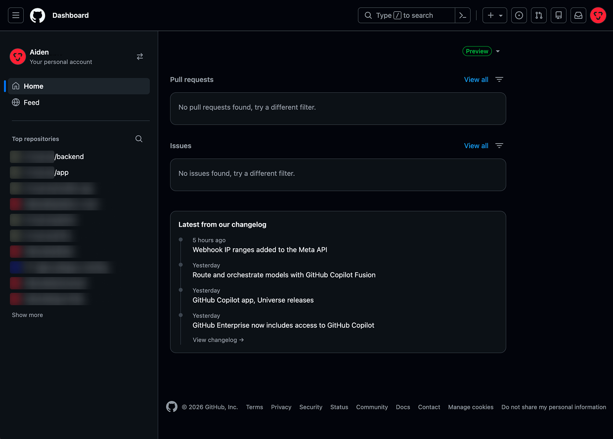
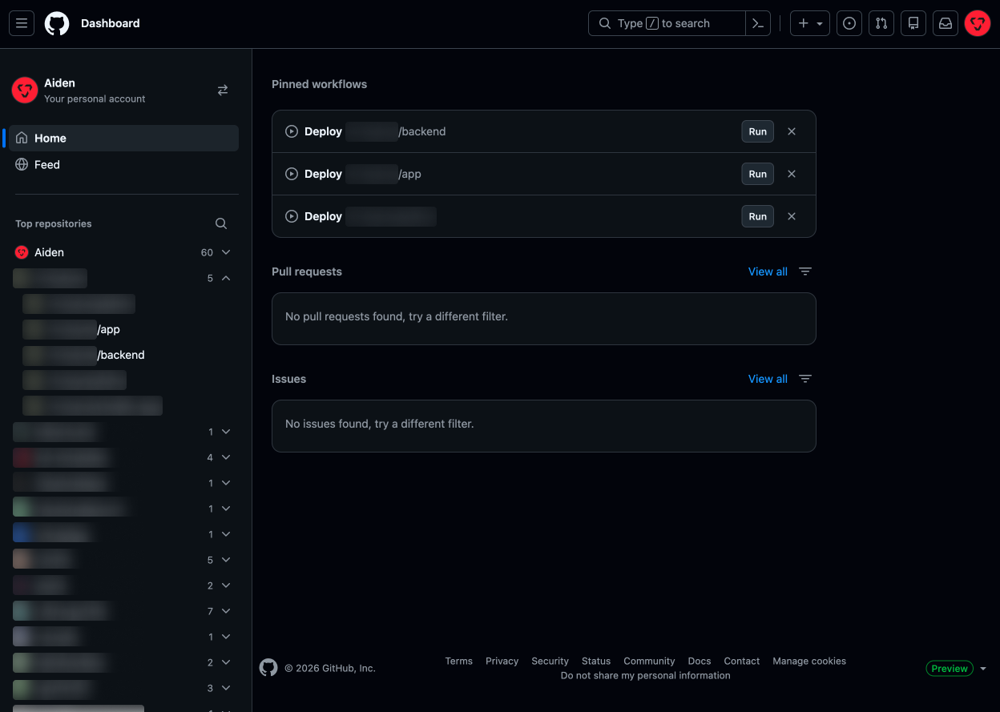

# Better Dashboard for GitHub

Расширение Chrome, для улучшения UI/UX на главной странице в GitHub

| До | После |
| --- | --- |
|  |  |

## Функционал

- **Группы репозиториев.** «Top repositories» в панели (слева) сгруппированы по аккаунтам, группы сворачиваются, всё отсортировано по алфавиту. Расширение автоматически подгружает весь список через кнопку Show more.
- **Закреплённые workflow.** На страницах GitHub Actions добавлена кнопка **Pin**. Закреплённые workflow показываются на главной для быстрого запуска.
- **Упрощение визуала.** Changelog удален, плашка Preview перенесена вниз. Я также рекомендую скрыть Copilot в настройках (Settings -> Copilot -> Features -> Visibility -> Show Copilot: Disabled).

## Установка

1. Скачайте [`dist/better-dashboard-for-github-0.2.0.zip`](dist/better-dashboard-for-github-0.2.0.zip)
2. Откройте `chrome://extensions` и включите **Developer mode** в правом верхнем углу.
3. Нажмите **Load unpacked** и выберите распакованную папку.
4. Обновите вкладку GitHub.

## Данные

Расширение работает только на github.com, ничего не отправляет на сторонние серверы и не запрашивает токены. Закреплённые workflow и свёрнутые группы хранятся в `localStorage`.

## Если что-то сломалось

GitHub часто меняет вёрстку. Если после обновления GitHub что-то перестало работать, откройте консоль браузера: расширение напишет туда строку, начинающуюся с `[ghx]`, с тем, какой элемент страницы оно не нашло.
